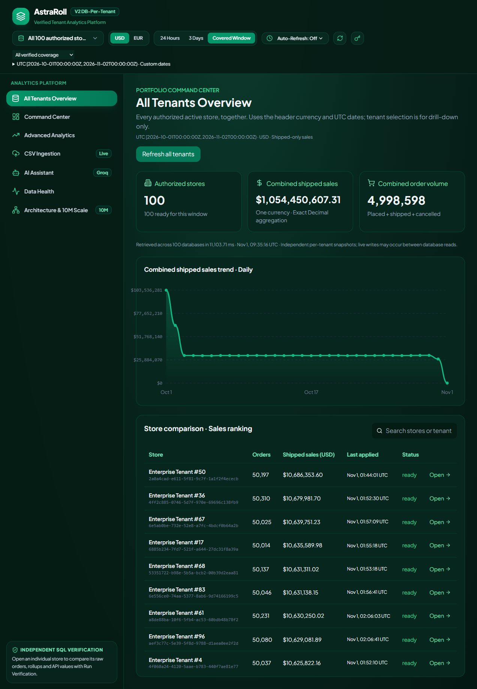

# All Tenants Overview



Open the dashboard on **http://127.0.0.1:8000**, authenticate with the existing operator key, then choose **All Tenants Overview** in the sidebar. A restricted key sees only its authorized active stores; the operator key can see all 100. This is a portfolio view across the dedicated databases, without moving orders into a shared database.

- Combined shipped sales and total order volume.
- Combined daily/hourly shipped-sales trends.
- Every authorized active store in a searchable, sales-ranked comparison table.
- Store-level last-applied timestamps and availability state.
- **Open** on any store returns to its Command Center.
- Header currency/date controls, manual refresh and non-overlapping auto-refresh apply.
- USD and EUR are separate views. Order counts are also currency-filtered.

The selected UTC window is applied identically to every store. Header presets use the existing coverage-based date selection; they do not silently choose different windows for different stores. Daily trends require midnight boundaries. Hourly portfolio windows are capped at 1,000 buckets; daily windows retain the 366-day bound.

## API and guarantees

```http
GET /analytics/portfolio?currency=USD&start=2026-10-01T00:00:00Z&end=2026-11-02T00:00:00Z&interval=day
Authorization: Bearer <existing-expiring-key>
```

The server discovers active tenant databases through the registry and applies the authenticated principal's membership before reading them. An administrator follows the existing administrator access policy. There is no caller-supplied database name and no authentication bypass.

The response includes `tenant_count`, `ready_tenant_count`, `complete`, `totals`, `buckets`, ranked `tenants`, read-start/read-completion timestamps and measured `retrieval_ms`. Monetary fields are Decimal strings. Ranking is shipped sales descending, order count descending, UUID ascending; unavailable stores follow ready stores.

Each store's totals and trends come from **one existing reader operation and one repeatable-read tenant snapshot**. The server sums exact UTC buckets with Decimal arithmetic. It reads existing rollups, never raw orders on the normal overview request, and creates no tables, migrations, consumers or duplicate reducers.

Snapshots are independent across databases. Live writes can occur between reads, so the response explicitly states `independent_tenant_snapshots`; no global checkpoint or simultaneous cross-database snapshot is invented. Individual durable freshness metadata is preserved.

If any store lacks trustworthy rollups or coverage, HTTP 200 carries `complete=false`, with `totals=null` and `buckets=null`. The table identifies unavailable stores while retaining ready store results. Missing data is never replaced by zero. A legitimately empty authorized scope or covered empty window returns genuine zero totals.

Authentication failures return 401. Invalid UTC dates/windows/intervals return 422. Registry/mode/tenant-limit failures return 503. One overview refresh per API process and at most two concurrent tenant reads bound fan-out; overlapping refreshes receive 429 with `Retry-After: 5`. The active tenant limit is 200. Responses use `Cache-Control: no-store`.

## Executed correctness checks — 1 November 2026

Independent raw-order SQL checked all **100 tenant rows** and all **32 combined daily buckets**, separately for each currency, for UTC `[2026-10-01, 2026-11-02)`:

| Currency | Currency-filtered orders |    Shipped sales | Reader retrieval | SQL parity |
| -------- | -----------------------: | ---------------: | ---------------: | ---------- |
| USD      |                4,998,598 | 1,054,450,607.31 |      5,963.12 ms | MATCH      |
| EUR      |                5,001,472 | 1,055,653,362.37 |      5,231.66 ms | MATCH      |

These are live observations following earlier demo writes, rather than a replacement for the preserved benchmark baseline. No orders or outbox entries were changed for this feature. SQL scans ran only in the independent verification harness. This cross-database fan-out timing is distinct from the four existing per-tenant API benchmark results; a browser cold refresh also observed 14,519.23 ms while regression work was running.

Backend tests cover exact Decimal sums, currency separation, authorization filtering/admin behavior, missing/invalid credentials, invalid dates, hourly/daily buckets, empty states, partial/all unavailable readers, deterministic ties and fan-out limits. Frontend tests cover rendering, search, drill-down, partial coverage and rejecting stale results after an error.

The full isolated backend regression passed **402 tests in 269.64 seconds**, with one existing deprecation warning. After adding two more boundary tests, the portfolio-specific suite passed **18 tests**. The frontend passed **15 tests**, ESLint and the production TypeScript/Vite build. Live HTTP verification with the restricted boundary key returned exactly one authorized store. Browser checks exercised all-store loading, search and store drill-down.

[Machine-readable SQL parity evidence](portfolio-evidence.json)
